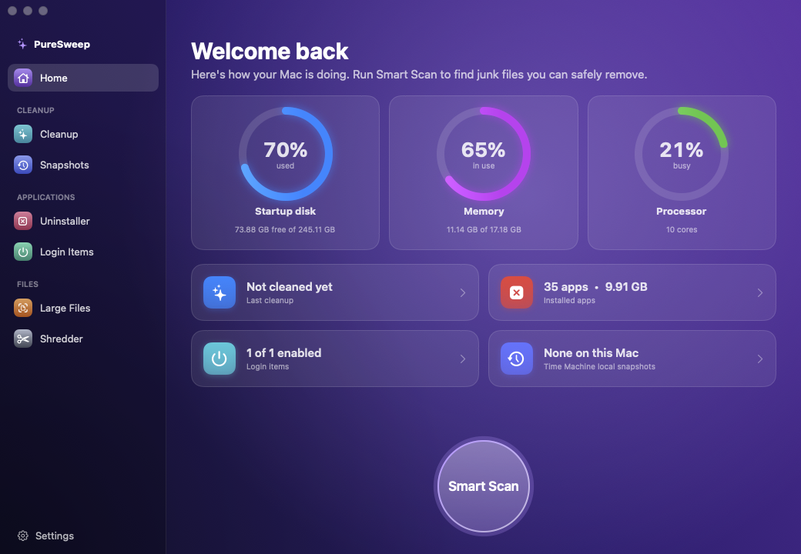
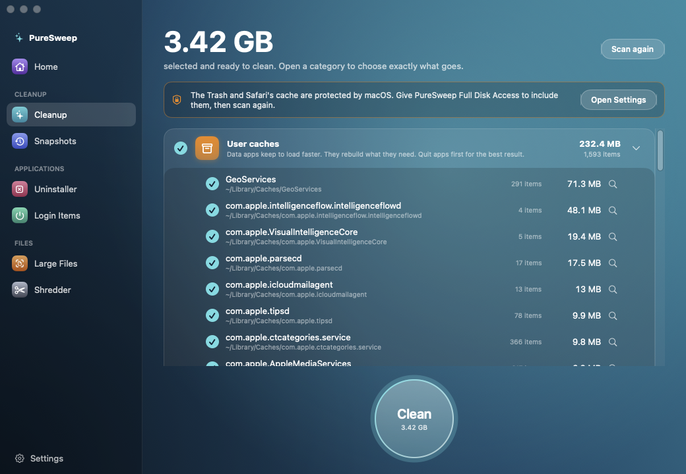

# PureSweep

A free, open-source cleaner for **Windows** and **macOS**. It finds junk files you can safely remove, uninstalls apps, manages what starts when you log in, shows space the system holds back, and securely shreds files.

Each version is a native app built for its own platform, not a cross-platform wrapper, and both share the same look: a dark window whose colour changes for each section, frosted panels, and one big round action button per page.

- **Windows:** WPF on .NET Framework 4.8.1, using [ModernWpf](https://github.com/Kinnara/ModernWpf) controls.
- **macOS:** SwiftUI for macOS 14 Sonoma and later, with a menu bar extra and Apple silicon and Intel support.

<p align="center">
  
  
</p>

> **Status: early release (1.0).** Scanning is read-only and safe. Cleaning, shredding, uninstalling and the system toggles delete or change real things, and have had limited real-world testing. Try them on throwaway data first. See [Safety](#safety).

## Features

| | Windows | macOS |
| --- | --- | --- |
| **Home** | Live disk, memory and CPU gauges, Smart Scan, cleaning history and shortcuts to every tool. | Same. |
| **Cleanup** | Nine categories of junk. Open any category to keep or clean individual folders. | Seven categories of junk, with the same drill-down. |
| **Uninstaller** | Lists programs with size, publisher and version, and runs each program's own uninstaller. | Lists apps with size and version. Moves the app **and the support files it left in ~/Library** to the Trash, so it can be undone. |
| **Startup / Login Items** | Turns sign-in items on or off with the same flags as Task Manager. | Turns launch agents and daemons on or off through `launchctl`. |
| **Hibernation / Snapshots** | Shows the space `hiberfil.sys` uses and turns hibernation on or off. | Lists Time Machine local snapshots and purgeable space, and deletes snapshots. |
| **Large Files** | — | Finds the biggest files in your home folder. Show in Finder or move to the Trash. |
| **Shredder** | Overwrites files or folders with random data (1, 3 or 7 passes), then deletes them. | Same, and shows whether FileVault is on. |
| **Settings** | Keep recent files, cleaning history. | Keep recent files, menu bar extra, open at login, Full Disk Access status. |

Startup and login-item changes never delete anything, so they can always be switched back.

### What Cleanup looks for

**Windows:** temporary files, Windows temporary files, browser caches (Chrome, Edge, Brave, Firefox), the Windows Update download cache, thumbnail and icon caches, crash dumps and error reports, the DirectX shader cache, Windows log files, and the Recycle Bin.

**macOS:** user caches, temporary files, browser caches (Safari, Chrome, Edge, Brave, Arc, Firefox), app logs, crash and hang reports, developer caches (Xcode, simulators, Homebrew, pip, Yarn, npm), and the Trash.

There is deliberately **no registry cleaner** on Windows, and no system-wide cleaning on macOS.

## Download and install

Prebuilt downloads will be attached to the [releases page](https://github.com/matthewdeluxe/PureSweep/releases). You can also [build it yourself](#build). Neither version is code-signed yet, so your system will warn the first time you open it.

### Windows

Run `PureSweep.msi` (recommended) or `PureSweepSetup.exe`. Both install **per user** to `%LocalAppData%\Programs\PureSweep` and need no administrator rights.

- Requires 64-bit Windows 10 or 11 and the .NET Framework 4.8.1 runtime (included with Windows 11 22H2 and later, a separate install on Windows 10).
- If SmartScreen warns, click **More info**, then **Run anyway**. Some antivirus products flag `PureSweepSetup.exe` because it is an unsigned exe that unpacks other exes. The MSI avoids that.
- Use one installer or the other, not both.
- Uninstalling removes the program and its settings folder (`%AppData%\PureSweep`).

**Administrator mode.** PureSweep runs as the invoking user. Cleaning the Windows temp folder, the Windows Update cache and Windows logs, and changing all-users startup items, need elevation: use **Restart as administrator** on the Cleanup page. The hibernation toggle asks for UAC on its own.

### macOS

Open `PureSweep.dmg` and drag PureSweep to Applications. Requires macOS 14 Sonoma or later, on Apple silicon or Intel.

Because the app isn't notarized by Apple, macOS blocks the first launch. You only need to do this once:

1. Open PureSweep. At the warning, click **Done** (not "Move to Trash").
2. Open **System Settings → Privacy & Security**, scroll down, and click **Open Anyway** next to the PureSweep message.
3. Confirm with your password or Touch ID, then click **Open**.

The same steps are in `How to open PureSweep.txt` inside the disk image.

**Full Disk Access (optional).** macOS blocks apps from reading the Trash and Safari's cache. To include them in Cleanup, turn PureSweep on in System Settings → Privacy & Security → Full Disk Access. Everything else works without it. Snapshot deletion and system daemons ask for an administrator password when needed.

## Safety

- **Scanning never deletes anything.** Cleaning asks for confirmation and names the categories it is about to empty.
- **Recent files are kept.** Temp, cache and log categories skip files changed in the last 24 hours (they may be in use) unless you turn that off in Settings. The check is repeated at the moment of deletion, not just at scan time.
- **The Recycle Bin and the Trash are not ticked by default**, since they are the safety net for deleted files.
- **Browser caches only.** History, cookies and saved logins are not touched. Files that are in use are left in place.
- **The Shredder refuses dangerous targets:** drive and volume roots, system folders, program folders, your Windows user profile, and your Mac home folder and its main folders (Desktop, Documents and so on). Symbolic links and junctions are removed, never followed. Shredding is permanent and skips the Recycle Bin and the Trash.
- **Shredding is not a guarantee on solid-state disks.** Overwriting in place works best on hard disks. SSDs, cloud-synced folders (OneDrive, iCloud Drive) and backups such as Volume Shadow Copies or Time Machine snapshots can keep other copies. Full-disk encryption (BitLocker or FileVault) is the dependable protection.
- **Windows uninstalls run each program's own uninstaller.** If PureSweep is running as administrator, uninstallers started from per-user entries also run elevated, so only elevate when you need to.
- **Mac uninstalls go to the Trash.** Leftover files are matched only by the app's exact bundle identifier or name, you can untick any of them, and Apple's own apps are not listed.
- Not covered by Startup management on Windows: RunOnce keys, scheduled tasks and services. On macOS, login items that apps register themselves are managed in System Settings → General → Login Items, which PureSweep links to.

Where settings live: `%AppData%\PureSweep\settings.txt` on Windows (unhandled errors go to `crash.log` in the same folder), and `~/Library/Preferences/com.puresweep.mac.plist` on macOS.

## Build

### Windows

Needs Visual Studio 2022 or the VS Build Tools (MSBuild with Roslyn) and the .NET Framework 4.8.1 targeting pack. There is no .NET SDK, NuGet restore or WiX involved.

```powershell
.\PureSweep\build.ps1
```

Output (git-ignored): `PureSweep\bin\PureSweep.exe`, `PureSweep\dist\PureSweep.msi` and `PureSweep\dist\PureSweepSetup.exe`.

To check that Windows changes compile without a Windows PC, run `dotnet build PureSweep/tools/compile-check` on macOS or Linux (needs the .NET SDK). It can't run the app.

The MSI is built with the Windows Installer COM API and `makecab.exe` (`tools\make-msi.ps1`). Each build gets a new ProductCode, and the fixed UpgradeCode makes it replace any installed version. ModernWpf is referenced as two prebuilt DLLs checked in under `PureSweep\lib`.

### macOS

Needs Xcode 15 or later, or just its command line tools (`xcode-select --install`). There is no Xcode project, only a Swift package.

```bash
./macOS/build.sh
```

Output (git-ignored): `macOS/dist/PureSweep.app` and `macOS/dist/PureSweep.dmg`, a universal build ready to share. `./macOS/build.sh --native` is faster but only runs on the kind of Mac that built it. The script can also sign with a Developer ID and notarize, which removes the first-launch warning but needs a paid Apple Developer account. See [`macOS/README.md`](macOS/README.md).

## Project layout

```
PureSweep/          Windows app (WPF)
  Core/             logic with no UI: junk scanning and cleaning, installed apps, startup items, shredder, helpers
  Controls/         Hero (page header), Emblem (start-screen glow) and RingGauge (dashboard dial)
  Pages/            one page per sidebar item
  Setup/            single-file exe installer (embeds the app)
  tools/            MSI builder, icon generator and a compile check that runs on macOS or Linux
  App.xaml          shared styles (glass cards, pill buttons, the big round button, sidebar items)
macOS/              macOS app (SwiftUI), see macOS/README.md
  Sources/PureSweep/Core/    logic with no UI
  Sources/PureSweep/Views/   one view per page, plus shared components
  build.sh          app bundle, icon, signing and disk image
docs/screenshots/   images used in this README
```

`CLAUDE.md` holds longer developer notes: behaviour worth knowing, build gotchas and testing status for both apps.

## Contributing

Issues and pull requests are welcome. There are no automated tests yet, so please describe how you verified a change and which platform you tried it on. Anything that deletes files should be tried against throwaway data.

## License

MIT, see [LICENSE](LICENSE). ModernWpf is also MIT licensed.
